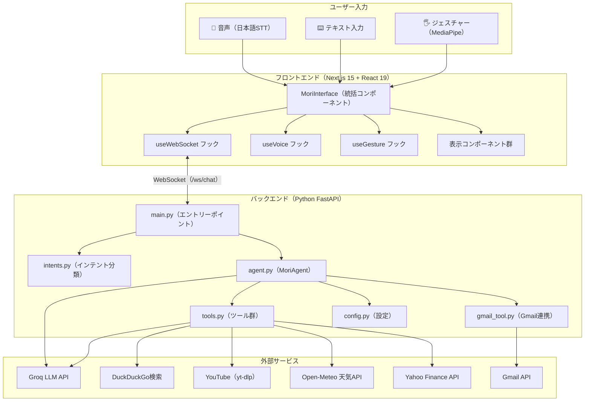
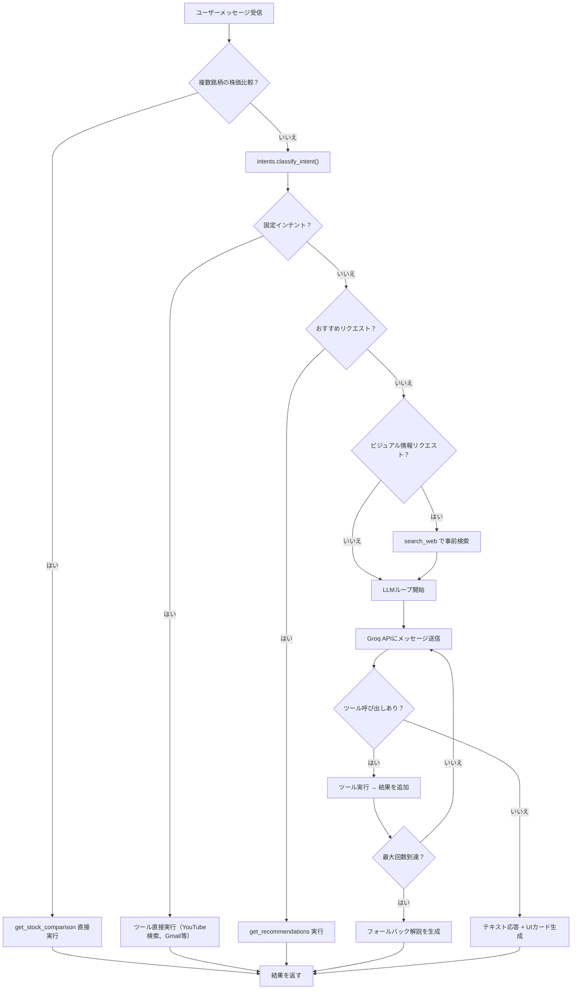
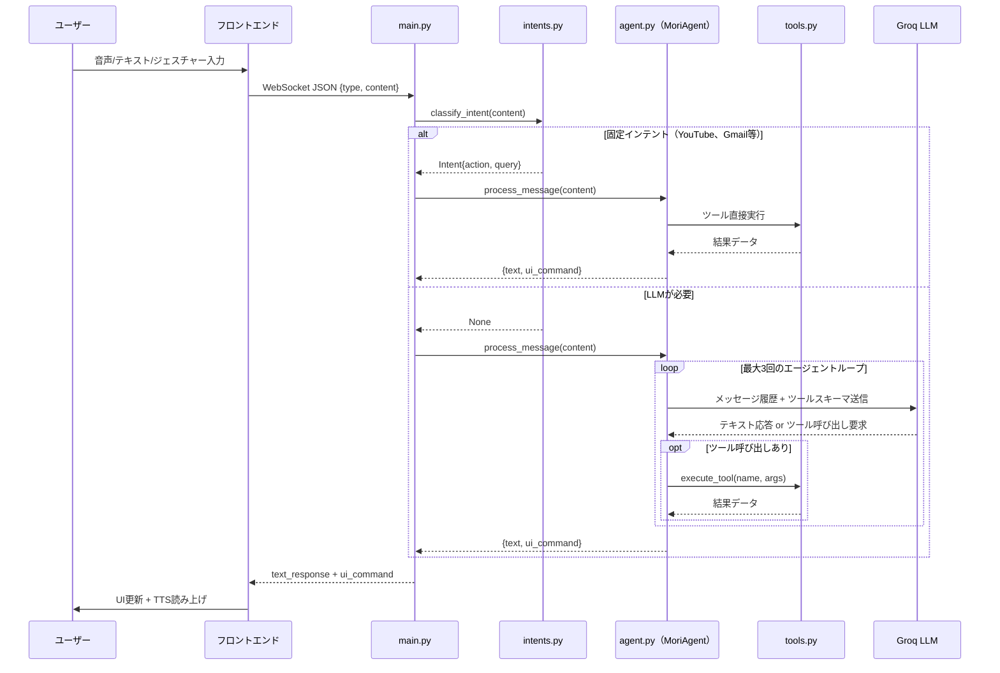

# 森 (M.O.R.I.) プロジェクト構成ガイド

> **M.O.R.I.** = **M**oriarty **O**perations **R**esearch **I**nterface  
> サイバーパンク風HUD UIを搭載した、日本語対応AIボイスアシスタント

---

## 📋 目次

1. [プロジェクト概要](#プロジェクト概要)
2. [全体アーキテクチャ](#全体アーキテクチャ)
3. [ディレクトリ構成](#ディレクトリ構成)
4. [ルートレベルのファイル](#ルートレベルのファイル)
5. [バックエンド (backend/)](#バックエンド-backend)
6. [フロントエンド (frontend/)](#フロントエンド-frontend)
7. [テストファイル (backend/tests/)](#テストファイル-backendtests)
8. [通信フローの詳細](#通信フローの詳細)
9. [技術スタック一覧](#技術スタック一覧)

---

## プロジェクト概要

**M.O.R.I.（森）** は、モリアーティ教授のペルソナを持つフルスタックAIボイスアシスタントです。

**主な機能：**
- 🎤 **音声入力/出力** — Web Speech APIによる日本語STT/TTS、ウェイクワード「モリ」対応、割り込み（バージイン）対応
- 🖐️ **ジェスチャー操作** — MediaPipeによるウェブカメラハンドトラッキング（スワイプ・拳認識）
- 💬 **テキスト入力** — コマンドコンソールからのテキスト入力
- 🌐 **ウェブ検索** — DuckDuckGoによるテキスト検索
- 📺 **YouTube検索・再生** — yt-dlpによる動画検索とアプリ内再生
- 📊 **グラフ生成** — LLMベースのグラフデータ生成とChart.jsによる描画
- 🌤️ **天気情報** — Open-Meteo APIによるリアルタイム天気情報
- 📈 **株価チャート** — Yahoo Finance APIで株価履歴を取得し比較チャート表示
- 📧 **Gmail連携** — Google OAuth 2.0によるメール閲覧
- 📚 **解説カード** — 検索結果に基づく構造化された解説表示
- 🍽️ **おすすめ表示** — 画像付きのおすすめカード表示
- 🤖 **エージェントループ** — 最大3回のツール呼び出しを含むLLM推論ループ

---

## 全体アーキテクチャ



---

## ディレクトリ構成

```
mori/
├── .gitignore                              # Git除外設定
├── README.md                               # プロジェクト説明書（日本語）
├── mori_project_specification_japanese.md   # 詳細プロジェクト仕様書（日本語）
├── start_mori.bat                          # Windows一括起動スクリプト
├── ai agent.mp4                            # デモ動画
│
├── backend/                                # バックエンド（Python/FastAPI）
│   ├── __init__.py                         # Pythonパッケージ初期化
│   ├── .env                                # 環境変数（秘密情報・Git管理外）
│   ├── .env.example                        # 環境変数テンプレート
│   ├── main.py                             # FastAPIエントリーポイント
│   ├── agent.py                            # AIエージェントコアロジック
│   ├── config.py                           # 設定・環境変数管理
│   ├── intents.py                          # インテント（意図）分類
│   ├── tools.py                            # 外部API連携ツール群（11種類）
│   ├── gmail_tool.py                       # Gmail API連携（OAuth 2.0）
│   ├── gmail_token.json                    # OAuthトークン（Git管理外）
│   ├── requirements.txt                    # Python依存パッケージ一覧
│   ├── GMAIL_OAUTH_SETUP.md                # Gmail OAuth設定手順ガイド
│   └── tests/                              # テストファイル
│       ├── test_intents.py                 # インテント分類テスト
│       ├── test_tools.py                   # ツール関数テスト
│       └── test_agent_intents.py           # エージェント統合テスト
│
└── frontend/                               # フロントエンド（Next.js/React）
    ├── package.json                        # NPMパッケージ設定
    ├── tsconfig.json                       # TypeScript設定
    ├── next.config.ts                      # Next.js設定
    ├── tailwind.config.ts                  # TailwindCSSカスタマイズ設定
    ├── postcss.config.mjs                  # PostCSS設定
    └── src/
        ├── app/
        │   ├── layout.tsx                  # ルートレイアウト
        │   ├── page.tsx                    # メインページ
        │   └── globals.css                 # グローバルCSS
        ├── components/
        │   ├── MoriInterface.tsx            # メイン統括コンポーネント（約430行）
        │   ├── ChatInput.tsx               # テキスト入力
        │   ├── CoreVisual.tsx              # AIコアビジュアル（待機画面）
        │   ├── MediaPanel.tsx              # メディアパネル（YouTube/Web検索）
        │   ├── MessageLog.tsx              # チャット履歴
        │   ├── ChartDisplay.tsx            # グラフ表示（棒/折れ線/円）
        │   ├── ExplainerDisplay.tsx        # 解説カード表示
        │   ├── GestureOverlay.tsx          # ジェスチャーオーバーレイ
        │   ├── GmailDisplay.tsx            # Gmail表示（受信/詳細/認証）
        │   ├── RecommendationDisplay.tsx   # おすすめカード表示
        │   ├── VideoPlayer.tsx             # YouTube動画プレイヤー（レガシー）
        │   └── WeatherDisplay.tsx          # 天気情報表示
        └── hooks/
            ├── useWebSocket.ts             # WebSocket通信フック
            ├── useVoice.ts                 # 音声認識/合成フック
            └── useGesture.ts               # ジェスチャー検出フック（MediaPipe）
```

---

## ルートレベルのファイル

### 📄 `.gitignore`

| 項目 | 説明 |
|------|------|
| **役割** | Gitバージョン管理から除外するファイル/フォルダを指定 |
| **除外対象** | `backend/.env`、`backend/gmail_token.json`、`backend/venv/`、`__pycache__/`、`*.py[cod]`、`frontend/node_modules/`、`frontend/.next/` |

---

### 📄 `README.md`

| 項目 | 説明 |
|------|------|
| **役割** | プロジェクト全体の説明書（日本語） |
| **内容** | ASCIIアーキテクチャ図、セットアップ手順（前提条件: Node.js 18+、Python 3.10+、Groq APIキー）、機能一覧表（音声・ウェイクワード・バージイン・検索・YouTube・チャート・エージェントループ・サイバーパンクUI）、技術スタック |

---

### 📄 `mori_project_specification_japanese.md`

| 項目 | 説明 |
|------|------|
| **役割** | プロジェクトの詳細仕様書（日本語） |
| **主な内容** | ① プロジェクト概要（全二重AIボイスアシスタント + Generative UI） ② ペルソナ定義（モリアーティ教授キャラクター、敬語、数学者風） ③ アーキテクチャ（サイバーパンクHUDフロントエンド + 非同期FastAPIバックエンド） ④ コア機能（ウェイクワード + 全二重VAD + バージイン、エージェントループ最大3回、Generative UI、ジェスチャートラッキング） ⑤ デスクトップ.exe化計画（Electron/Tauri） |

---

### 📄 `start_mori.bat`

| 項目 | 説明 |
|------|------|
| **役割** | Windows用の一括起動バッチスクリプト |
| **動作手順** | ① Python仮想環境が存在しない場合は作成し、`requirements.txt` をインストール ② 新しいウィンドウ「MORI-Backend」でuvicornバックエンドを起動（ポート8000、`--reload`付き） ③ 3秒待機後、新しいウィンドウ「MORI-Frontend」で`npm run dev`を起動（ポート3000） ④ キー入力待ちで停止、両プロセスをウィンドウタイトルで終了 |

---

## バックエンド (backend/)

### 📄 `__init__.py`

| 項目 | 説明 |
|------|------|
| **役割** | `backend` ディレクトリをPythonパッケージとして認識させるための空ファイル |

---

### 📄 `config.py`（38行）

| 項目 | 説明 |
|------|------|
| **役割** | 一元的な設定管理モジュール |
| **使用ライブラリ** | `pydantic-settings`、`python-dotenv` |

**`Settings` クラスの設定項目：**

| 設定名 | デフォルト値 | 説明 |
|--------|-------------|------|
| `GROQ_API_KEY` | （必須） | Groq LLM APIキー |
| `MODEL_NAME` | `"openai/gpt-oss-120b"` | 使用するLLMモデル名 |
| `GOOGLE_OAUTH_CLIENT_ID` | （必須） | Gmail OAuth クライアントID |
| `GOOGLE_OAUTH_CLIENT_SECRET` | （必須） | Gmail OAuth クライアントシークレット |
| `GOOGLE_OAUTH_REDIRECT_URI` | `http://localhost:8000/api/gmail/oauth/callback` | OAuthリダイレクトURI |
| `FRONTEND_ORIGIN` | `http://localhost:3000` | フロントエンドのURL |
| `SYSTEM_PROMPT` | （長文の日本語プロンプト） | モリアーティのペルソナ定義、会話ルール（簡潔・共感・自然な日本語）、ツール使用指示（`show_explainer`、`search_web`、`get_stock_history`、`show_chart`、`get_weather`、`open_gmail`、`check_gmail` など） |

---

### 📄 `main.py`（265行）

| 項目 | 説明 |
|------|------|
| **役割** | FastAPIアプリケーションのエントリーポイント（HTTPサーバー + WebSocketサーバー） |
| **使用ライブラリ** | `FastAPI`、`WebSocket`、`CORSMiddleware`、`google_auth_oauthlib` |

**エンドポイント一覧：**

| エンドポイント | メソッド | 説明 |
|---------------|---------|------|
| `/ws/chat` | WebSocket | メイン通信チャネル。JSONメッセージ（`type` + `content`）を受信 → インテント分類 → `agent.process_message()` で処理 → `text_response` と `ui_command` を返送 |
| `/api/gmail/oauth/login` | GET | Google OAuth PKCE フローを開始。`state` トークンと `code_verifier` を生成し、認証URLにリダイレクト |
| `/api/gmail/oauth/callback` | GET | Googleからの認証コードを受信し、トークンに交換。`postMessage` でフロントエンドウィンドウに通知 |
| `/api/chat` | POST | REST版のチャットエンドポイント（テスト用） |
| `/health` | GET | ヘルスチェック |

**WebSocketが送信するメッセージの種類：**

| メッセージタイプ | 説明 |
|----------------|------|
| `text_response` | LLMのテキスト応答 |
| `ui_command` | UIの変更命令。以下の約16種類のコマンドをサポート |

**`ui_command` の種類：**

| コマンド | 説明 |
|---------|------|
| `media_loading` | メディア読み込み中のローディング表示 |
| `show_media` | YouTube/ウェブ検索結果の表示 |
| `show_chart` | 単一グラフの表示 |
| `show_chart_collection` | 複数ページのグラフ集の表示 |
| `show_weather` | 天気情報の表示 |
| `navigate_media` | メディアリスト内のナビゲーション |
| `select_media` | メディアアイテムの選択 |
| `control_youtube` | YouTube再生の制御（ミュート解除・全画面） |
| `set_console` | コマンドコンソールの表示/非表示 |
| `show_gmail` | Gmail受信トレイの表示 |
| `show_gmail_auth` | Gmail認証プロンプトの表示 |
| `show_gmail_detail` | メール詳細の表示 |
| `show_explainer` | 解説カードの表示 |
| `show_recommendations` | おすすめカードの表示 |
| `gmail_opened` | ブラウザでGmailを開いた通知 |
| `reset` | デフォルト画面に戻す |

---

### 📄 `agent.py`（358行）

| 項目 | 説明 |
|------|------|
| **役割** | AIエージェントのコアロジック — プロジェクト全体の「頭脳」 |
| **使用ライブラリ** | `groq.AsyncGroq` |

**ヘルパー関数：**

| 関数名 | 説明 |
|--------|------|
| `_concise_reply(text, limit=420)` | LLM出力を約420文字に切り詰める。日本語の文末（。！？）で区切る |
| `_follow_up_cards(text)` | 散文を最大6枚のUIカード（要点/補足/確認事項 など）に分割する |
| `_result_cards(results)` | ウェブ検索結果を最大6枚のビジュアルカードに変換する |

**`MoriAgent` クラスの主要処理フロー：**



**エージェントループの仕組み：**
- 事前検索あり → 最大 **1回** のLLM呼び出し
- 事前検索なし → 最大 **3回** のLLM呼び出し（ツール呼び出しを含む）
- 各反復で: メッセージ履歴をGroq APIに送信 → モデルがツール呼び出しを要求 → ツール実行 → 結果を履歴に追加 → 次の反復

---

### 📄 `intents.py`（127行）

| 項目 | 説明 |
|------|------|
| **役割** | 正規表現ベースのインテント（意図）分類モジュール。LLMに渡す前に高速で確定的なアクションを処理する |

**分類の優先順位：**

| 優先度 | インテント | 検出パターン例 | 説明 |
|--------|-----------|---------------|------|
| 1 | `next` / `previous` | 次へ / 前へ | ナビゲーション |
| 2 | `close` | 閉じて / 戻して | UI画面を閉じる |
| 3 | `console_control` | コンソールオン / オフ | コンソール表示切替 |
| 4 | `read_gmail` | 第N件を読んで | 特定メールの閲覧 |
| 5 | `select_media` | 第N個を再生 | メディア選択（1始まりインデックス） |
| 6 | `media_control` | ミュート解除 / 全画面 | メディア操作 |
| 7 | `check_gmail` / `open_gmail` | メール確認 / Gmailを開いて | Gmail操作 |
| 8 | `youtube_search` / `open_youtube` | ユーチューブで〇〇検索 | YouTube操作 |
| 9 | `web_search` / `open_search` | ネットで検索 / 調べて | ウェブ検索 |
| 10 | `None` | （上記に該当しない場合） | LLMエージェントに委譲 |

**特殊機能：**

| 関数名 | 説明 |
|--------|------|
| `_selected_number(message)` | 日本語の序数表現（「第3個」「二番目」）を1始まりの整数に変換 |
| `_extract_query(message)` | YouTube/ウェブのキーワードを除去し、検索クエリを抽出 |
| `wants_sources(message)` | ユーザーがソース/参考文献/URLを要求しているか判定 |

---

### 📄 `tools.py`（543行）

| 項目 | 説明 |
|------|------|
| **役割** | 外部APIと連携する全ツール関数群（11種類）+ OpenAI互換のツールスキーマ定義 |

**ツール関数一覧：**

| 関数名 | 使用API | 説明 |
|--------|---------|------|
| `search_web(query)` | DuckDuckGo (`DDGS`) | ウェブテキスト検索。結果を整形テキストとして返す |
| `search_web_results(query)` | DuckDuckGo (`DDGS`) | ウェブ検索の生データ（`{title, snippet, url}`）を返す |
| `get_recommendations(query)` | DuckDuckGo + 画像検索 | ウェブ検索 + 画像検索を組み合わせ、画像付きおすすめカードを生成 |
| `play_youtube(query)` | yt-dlp (`ytsearch12:`) | 最大12件のYouTube動画を検索。ID・タイトル・サムネイル・チャンネル・概要を返す |
| `show_chart(type, title, labels, values)` | （なし） | グラフデータ（棒/円/折れ線）をフロントエンド描画用に整形 |
| `get_weather(location)` | Open-Meteo（地理コーディング + 天気予報API） | 気温・湿度・風速・天気状態を日本語で返す |
| `get_stock_history(symbol, days)` | Yahoo Finance（公開チャートAPI） | 指定銘柄の日次終値データを取得 |
| `get_stock_comparison(symbols, days)` | Yahoo Finance | 2～5銘柄の株価を比較チャートとして表示。銘柄別ページまたは重ね表示に対応 |
| `show_explainer(title, summary, cards)` | （なし） | 解説カードデータをフロントエンド表示用に整形 |
| `open_gmail()` | （なし） | ブラウザでGmailを開くUIコマンドを返す |
| `check_gmail(count, unread_only)` | Gmail API | 受信メール一覧（最大30件）を取得。未読数も返す |
| `read_gmail_message(message_id)` | Gmail API | メール本文を取得（テキスト優先、HTMLフォールバック、最大12,000文字） |
| `close_ui()` | （なし） | デフォルト画面に戻すリセットコマンド |

**`TOOLS_SCHEMA`：**
- 上記ツールのOpenAI互換関数定義（JSON Schema形式）
- Groq APIのファンクションコーリング機能で使用される
- `execute_tool(name, arguments)` ディスパッチャーで関数名からツールを実行

---

### 📄 `gmail_tool.py`（200行）

| 項目 | 説明 |
|------|------|
| **役割** | Gmail APIとの連携モジュール（読み取り専用、OAuth 2.0認証） |
| **使用ライブラリ** | `google-auth-oauthlib`、`google-api-python-client` |
| **スコープ** | `https://www.googleapis.com/auth/gmail.readonly` |

**主要関数：**

| 関数名 | 説明 |
|--------|------|
| `oauth_is_configured()` | OAuthクライアントIDとシークレットが設定されているか確認 |
| `_load_credentials()` | `gmail_token.json` からトークンを読み込み、期限切れならリフレッシュ |
| `save_credentials(credentials)` | OAuthトークンJSONをディスクに保存 |
| `_gmail_service()` | Gmail API v1サービスオブジェクトを構築 |
| `open_gmail()` | ブラウザで `https://mail.google.com` を開くUIコマンドを返す |
| `check_gmail(count, unread_only)` | 受信トレイからメール一覧を取得（ID・送信者・件名・日付・プレビュー・未読状態 + 未読数） |
| `read_gmail_message(message_id)` | 完全なメール本文を取得（プレーンテキスト優先、HTMLフォールバック） |

**ヘルパークラス/関数：**
- `_HTMLTextExtractor` — HTMLからテキストを抽出（`<style>`/`<script>` タグをスキップ）
- `_header()`, `_date()`, `_sender()`, `_decode_body()`, `_body()` — メールのメタデータと本文を解析

---

### 📄 `requirements.txt`

| パッケージ | 用途 |
|-----------|------|
| `fastapi` | Webフレームワーク |
| `uvicorn` | ASGIサーバー |
| `websockets` | WebSocket通信 |
| `python-dotenv` | 環境変数読み込み |
| `groq` | Groq LLMクライアント |
| `ddgs` | DuckDuckGo検索 |
| `numpy` | 数値計算 |
| `pydantic` | データバリデーション |
| `pydantic-settings` | 設定管理 |
| `yt-dlp` | YouTube動画検索/メタデータ取得 |
| `google-api-python-client` | Google API（Gmail） |
| `google-auth-oauthlib` | Google OAuth認証 |

---

### 📄 `.env.example`

| 項目 | 説明 |
|------|------|
| **役割** | 環境変数のテンプレートファイル |
| **記載変数** | `GROQ_API_KEY`、`MODEL_NAME`、`GOOGLE_OAUTH_CLIENT_ID`、`GOOGLE_OAUTH_CLIENT_SECRET`、`GOOGLE_OAUTH_REDIRECT_URI`、`FRONTEND_ORIGIN` |
| **注意** | Gmailのパスワードは追加しないこと（OAuth使用のため） |

---

### 📄 `GMAIL_OAUTH_SETUP.md`

| 項目 | 説明 |
|------|------|
| **役割** | Gmail OAuth設定の日本語ステップバイステップガイド |
| **手順** | ① Google Cloudプロジェクト作成 → ② Gmail API有効化 → ③ OAuth同意画面設定（External、テストユーザー追加） → ④ Web OAuthクライアント作成（リダイレクトURI: `http://localhost:8000/api/gmail/oauth/callback`） → ⑤ `.env` に認証情報追加 → ⑥ 再起動して「Gmailを開いて」でログイン |
| **備考** | `gmail_token.json` はローカル専用でGitignore対象。アカウント切替時は削除 |

---

## フロントエンド (frontend/)

### ⚙️ 設定ファイル

#### 📄 `package.json`

| 項目 | 説明 |
|------|------|
| **プロジェクト名** | `mori-frontend` |
| **フレームワーク** | Next.js 15 + React 19 |
| **主要依存** | `next`、`react`、`react-dom`、`@mediapipe/tasks-vision`（ハンドトラッキング） |
| **開発依存** | TypeScript 5、TailwindCSS 3.4、ESLint 9、`eslint-config-next` |

#### 📄 `tsconfig.json`

| 項目 | 説明 |
|------|------|
| **ターゲット** | ES2017 |
| **特徴** | strictモード有効、パスエイリアス `@/*` → `./src/*`、Next.js TypeScriptプラグイン |

#### 📄 `next.config.ts`

| 項目 | 説明 |
|------|------|
| **内容** | デフォルト設定（カスタム設定なし） |

#### 📄 `tailwind.config.ts`

| 項目 | 説明 |
|------|------|
| **カスタムカラー** | `neon-cyan` (#00f0ff)、`neon-magenta` (#ff00ff)、`neon-green` (#00ff41)、`hud-dark` (#0a0a0f)、`hud-border`（半透明シアン） |
| **カスタムアニメーション** | `pulse-neon`（ネオン脈動）、`scan-line`（垂直スキャンライン）、`breathing`（スケール呼吸） |

#### 📄 `postcss.config.mjs`

| 項目 | 説明 |
|------|------|
| **内容** | `tailwindcss` プラグインのみ |

---

### 🎨 アプリケーション (src/app/)

#### 📄 `layout.tsx`

| 項目 | 説明 |
|------|------|
| **役割** | Next.jsのルートレイアウト |
| **HTML言語** | `ja`（日本語） |
| **タイトル** | "M.O.R.I. - Tactical AI Command" |
| **説明** | "Cyberpunk AI Voice Assistant Interface" |
| **スタイル** | `globals.css` をインポート |

#### 📄 `page.tsx`

| 項目 | 説明 |
|------|------|
| **役割** | アプリのメインページ（シングルページ） |
| **内容** | 装飾的なHUDボーダーオーバーレイ + `<MoriInterface />` コンポーネントをレンダリング |

#### 📄 `globals.css`

| 項目 | 説明 |
|------|------|
| **フォント** | Google Fonts: **Orbitron**（見出し用）、**Rajdhani**（本文用） |
| **CSS変数** | `--background: #0a0a0f`、`--foreground: #e0e0e0` |
| **ボディ** | ダーク背景、Rajdhaniフォント、`overflow: hidden`、シアン色のグリッドライン背景パターン |
| **スクロールバー** | シアンテーマの細いスクロールバー |

---

### 🧩 コンポーネント (src/components/)

#### 📄 `MoriInterface.tsx` — メイン統括コンポーネント（約430行）

| 項目 | 説明 |
|------|------|
| **役割** | **フロントエンド全体の中枢**。全UIステート、WebSocket通信、音声I/O、ジェスチャー制御、画面表示切り替えを統合管理する最重要コンポーネント |

**主要ステート：**

| ステート | 型 | 説明 |
|---------|----|------|
| `messages` | `Message[]` | チャット履歴 |
| `currentUI` | `UIMode` | 現在の表示モード |
| `mediaData` | `MediaData` | YouTube/Web検索データ |
| `chartData` / `chartPages` / `chartIndex` | 各種 | グラフデータとページネーション |
| `weatherData` | `WeatherData` | 天気データ |
| `gmailData` / `gmailDetail` / `gmailAuth` | 各種 | Gmailデータ |
| `explainerData` / `explainerIndex` | 各種 | 解説カードデータ |
| `recommendationData` | `RecommendationData` | おすすめデータ |
| `showConsole` | `boolean` | コンソール表示/非表示 |
| `gestureEnabled` | `boolean` | ジェスチャートラッキングON/OFF |

**UIモード（`currentUI` の値）：**

| モード | 表示内容 |
|--------|---------|
| `core` | CoreVisual（待機画面のアニメーションオーブ） |
| `media` | MediaPanel（YouTube/Web検索結果） |
| `chart` | ChartDisplay（グラフ） |
| `weather` | WeatherDisplay（天気情報） |
| `gmail` | GmailDisplay（メール一覧/詳細/認証） |
| `explainer` | ExplainerDisplay（解説カード） |
| `recommendations` | RecommendationDisplay（おすすめカード） |

**使用フック：**
- `useWebSocket('ws://localhost:8000/ws/chat', callback)` — `text_response` と `ui_command` の2種類のメッセージを処理
- `useVoice(onResult, onWakeWord)` — 音声認識 + TTS
- `useGesture(handleGesture, gestureEnabled)` — ジェスチャー検出

**ジェスチャーマッピング：**

| ジェスチャー | アクション |
|-------------|-----------|
| 左スワイプ | メディア/チャート/解説カードの前へ移動 |
| 右スワイプ | メディア/チャート/解説カードの次へ移動 |
| 拳（✊） | 画面を閉じてコアビューに戻る |

**UIレイアウト：**
- **ヘッダーバー** — M.O.R.I.ロゴ、システムバージョン、リアルタイム時計（日本語ロケール）、接続状態LED、ジェスチャートラッキングインジケーター
- **メインコンテンツ** — `currentUI` に基づいてコンポーネントを条件分岐レンダリング
- **サイドバー** — MessageLog（コンソール表示時のみ）
- **入力バー** — ChatInput（コンソール表示時のみ）
- **装飾** — スキャンラインオーバーレイ

---

#### 📄 `ChatInput.tsx`（56行）

| 項目 | 説明 |
|------|------|
| **役割** | テキスト入力バー + マイク切り替えボタン |
| **Props** | `onSend: (text) => void`、`isListening: boolean`、`onToggleListen: () => void` |
| **UI要素** | マイクトグルボタン（聴取中: マゼンタ脈動、待機中: シアンアイコン）、テキスト入力欄（プレースホルダー: "コマンドを入力..."）、送信ボタン |

---

#### 📄 `CoreVisual.tsx`（55行）

| 項目 | 説明 |
|------|------|
| **役割** | AIアシスタントのデフォルト待機画面 — 同心円アニメーション |
| **Props** | `status: AIStatus`（`idle` / `listening` / `speaking` / `thinking`） |

**状態別ビジュアル：**

| 状態 | 色 | 表示テキスト |
|------|----|-------------|
| `idle` | シアン | STANDBY |
| `listening` | マゼンタ | AWAITING_INPUT |
| `speaking` | グリーン | TRANSMITTING |
| `thinking` | イエロー | PROCESSING |

**ビジュアル構成：** 外側リング（低速回転）、中間リング（破線、逆回転）、内側コア（発光）。"M.O.R.I."タイトルとステータステキスト。

---

#### 📄 `MediaPanel.tsx`（271行）

| 項目 | 説明 |
|------|------|
| **役割** | YouTube動画再生とウェブ検索結果の統合メディアパネル |

**3つの表示モード：**

| モード | 条件 | 表示内容 |
|--------|------|---------|
| Webプレビュー | `mode='web'` + `webPreviewOpen=true` | サンドボックス化されたiframeで選択URLを全画面表示 |
| YouTubeグリッド | 動画未選択（index = -1） | レスポンシブグリッド（1〜3列）で動画サムネイル一覧 |
| プレイヤー+サイドバー | 動画選択済み | 左にYouTube埋め込み（ミュート解除/全画面ボタン付き）、右にスクロール可能な結果リスト |

**特殊機能：**
- YouTubeはプライバシー保護のため `youtube-nocookie.com` を使用
- バックエンドからの `playerActions`（`['unmute']`、`['fullscreen']`）で音声制御可能
- 検索フォームで再検索可能

---

#### 📄 `MessageLog.tsx`（43行）

| 項目 | 説明 |
|------|------|
| **役割** | スクロール可能なチャット履歴サイドバー |
| **スタイル** | ユーザーメッセージ: シアンボーダー（USR）、M.O.R.I.メッセージ: マゼンタボーダー（SYS） |
| **機能** | 新メッセージで自動スクロール、タイムスタンプ表示 |

---

#### 📄 `ChartDisplay.tsx`（100行）

| 項目 | 説明 |
|------|------|
| **役割** | SVGベースのグラフ表示コンポーネント |
| **対応チャートタイプ** | 棒グラフ、折れ線グラフ |
| **特殊機能** | 複数系列の折れ線チャート（最大5色: マゼンタ、シアン、グリーン、イエロー、ピンク）、SVGポリライン描画、ホバーで値表示、ページネーション対応（← PREVIOUS / NEXT →） |

---

#### 📄 `ExplainerDisplay.tsx`（69行）

| 項目 | 説明 |
|------|------|
| **役割** | ナビゲーション可能な解説カードの表示 |

**カードの種類：**

| 種類 | アイコン | ラベル | ボーダー色 |
|------|---------|--------|-----------|
| `what` | ? | 概要 | （デフォルト） |
| `how` | → | ポイント | （異なる色） |
| `why` | ! | 理由 | （異なる色） |
| `care` | ✓ | 注意 | （異なる色） |
| `list` | ☷ | 一覧 | （異なる色） |

**機能：** ヘッダー（タイトル + サマリー）、カード切り替え（← 前へ / 次へ →）、ソースボタン（クリックでWebプレビュー表示）

---

#### 📄 `GestureOverlay.tsx`（167行）

| 項目 | 説明 |
|------|------|
| **役割** | ハンドトラッキングのカメラプレビュー、スケルトン可視化、切り替えボタン |
| **機能** | ミラー表示のウェブカメラ映像上にキャンバスで手のスケルトンを描画。シアンの接続線、指先にマゼンタのグロー効果 |

**ジェスチャー通知ラベル：**

| ラベル | 意味 |
|--------|------|
| ← PREVIOUS | 左スワイプ検出 |
| NEXT → | 右スワイプ検出 |
| ✊ CLOSE DISPLAY | 拳検出 |

**ステータス表示：** HAND TRACKING（緑・追跡中）、HAND SEARCHING（黄・検索中）、CAMERA/MODEL ERROR（赤・エラー）

---

#### 📄 `GmailDisplay.tsx`（197行）

| 項目 | 説明 |
|------|------|
| **役割** | Gmail統合表示（3つのビュー） |

| ビュー | 条件 | 内容 |
|--------|------|------|
| 認証ビュー | `auth` プロップ設定時 | Google ログインプロンプト + OAuthボタン |
| 詳細ビュー | `detail` プロップ設定時 | 単一メール表示（件名・送信者・日付・本文）+ ← INBOX 戻るボタン |
| 受信トレイ | デフォルト | スクロール可能なメール一覧（未読マーカー付き）、クリックで詳細表示 |

**フッター：** 「音声: 『第1件を読んで』」のヒント表示

---

#### 📄 `RecommendationDisplay.tsx`（45行）

| 項目 | 説明 |
|------|------|
| **役割** | おすすめカードのグリッド表示（レストラン、場所等の提案） |
| **レイアウト** | レスポンシブ1〜3列グリッド |
| **カード内容** | 画像（または"IMAGE UNAVAILABLE"プレースホルダー）、タイトル、概要、"SOURCE ↗"リンク |
| **操作** | クリックでWebプレビュー表示 |

---

#### 📄 `VideoPlayer.tsx`（34行）

| 項目 | 説明 |
|------|------|
| **役割** | 単体YouTube動画プレイヤー |
| **状態** | **レガシー/未使用** — 現在の動画再生は `MediaPanel.tsx` で処理。このコンポーネントはコードベース内でインポートされていない |

---

#### 📄 `WeatherDisplay.tsx`（33行）

| 項目 | 説明 |
|------|------|
| **役割** | 天気情報カードの表示 |
| **表示内容** | 場所名（Orbitronフォント）、大きな気温表示、天気状態テキスト |
| **統計グリッド（3列）** | FEELS LIKE（体感温度）、HUMIDITY（湿度）、WIND（風速） |

---

### 🪝 カスタムフック (src/hooks/)

#### 📄 `useWebSocket.ts`（80行）

| 項目 | 説明 |
|------|------|
| **役割** | WebSocket通信を管理するカスタムReactフック |
| **接続先** | `ws://localhost:8000/ws/chat` |
| **機能** | 自動再接続（3秒間隔）、接続状態管理（`isConnected`）、JSON送受信、最新コールバックをrefで保持（stale closure回避）、アンマウント時クリーンアップ |
| **返却値** | `{ isConnected, sendMessage }` |

---

#### 📄 `useVoice.ts`（133行）

| 項目 | 説明 |
|------|------|
| **役割** | 音声認識（STT）と音声合成（TTS）を管理するカスタムフック |

**音声認識（STT）：**

| 項目 | 詳細 |
|------|------|
| API | `SpeechRecognition` / `webkitSpeechRecognition` |
| 言語 | `ja-JP`（日本語） |
| モード | 連続認識、中間結果なし |
| ウェイクワード | 「モリ」「モリアーティ」 |
| バージイン | ユーザーが話し始めるとTTSを自動キャンセル |
| 自動再起動 | 認識終了時にリスニング中なら自動再開 |

**音声合成（TTS）：**

| 項目 | 詳細 |
|------|------|
| API | `SpeechSynthesisUtterance` |
| 言語 | `ja-JP`（日本語音声を優先選択） |
| 状態管理 | `isSpeaking` で発話中を追跡 |

**返却値：** `{ isListening, isSpeaking, startListening, stopListening, speak, transcript }`

---

#### 📄 `useGesture.ts`（245行）

| 項目 | 説明 |
|------|------|
| **役割** | MediaPipe HandLandmarkerを使ったリアルタイムハンドジェスチャー認識 |
| **使用ライブラリ** | `@mediapipe/tasks-vision`（動的インポート、CDN読み込み） |

**検出ジェスチャー：**

| ジェスチャー | 検出条件 |
|-------------|---------|
| `swipe_left` | 4本以上の指を伸ばした状態で左方向に移動（正規化距離0.09以上、80〜450ms、水平優位1.7倍、方向一貫性75%以上） |
| `swipe_right` | 同上（右方向） |
| `fist` | 全指先がパーム中心に近い状態を300ms以上保持 |

**技術的詳細：**
- ウェブカメラ: 640×480、ユーザー向きカメラ
- GPU デリゲート優先（CPUフォールバック）
- `requestAnimationFrame` ループで `detectForVideo()` を実行
- 指数平滑法（α=0.45）でパーム位置を追跡
- ジェスチャー間700msのクールダウン
- 座標はカメラプレビューに合わせてミラーリング

**返却値：** `{ isActive, currentGesture, landmarks, detectionStatus, videoRef, canvasRef, start, stop }`

---

## テストファイル (backend/tests/)

### 📄 `test_intents.py`（52行、9テスト）

| テスト | 検証内容 |
|--------|---------|
| YouTube開く（クエリなし） | 「YouTubeを開いて」→ `open_youtube` |
| YouTube検索クエリ抽出 | クエリの正確な抽出 |
| Web検索クエリ抽出 | クエリの正確な抽出 |
| 検索画面を開く | `open_search` |
| YouTube + Web の優先度 | YouTube優先 |
| メディアナビゲーション | 次へ/閉じる |
| 番号付き動画選択 | 「第3個」→ index 2 |
| メディア操作の組み合わせ | ミュート解除 + 全画面 |
| コンソールON/OFF | コンソール制御 |
| 番号付きメール閲覧 | 「第2件を読んで」→ index 1 |

---

### 📄 `test_tools.py`（63行、4テスト）

| テスト | 検証内容 |
|--------|---------|
| 解説カードの保持 | `show_explainer` がカード数と改行を保持するか |
| ウェブ検索の結果構造 | DDGSモック → 結果構造の検証 |
| YouTube検索の動画メタデータ | yt-dlpモック → ID・タイトル・チャンネル・サムネイルの検証 |
| おすすめカードの画像付き | DDGS + 画像モック → カードに画像が含まれるか |

---

### 📄 `test_agent_intents.py`（78行、7テスト）

| テスト | 検証内容 |
|--------|---------|
| YouTubeを開く（LLM不使用） | 「YouTubeを開いて」がGroq APIを呼ばずに処理されるか |
| YouTube検索が解説カードをバイパス | `play_youtube` が呼ばれ、解説カードにならないか |
| Web検索の分類 | Web検索インテントは認識されるがエージェントが実行計画を立てるか |
| フォローアップカードの数 | `_follow_up_cards` が2文に対して正確に2枚のカードを生成するか |
| 新しい質問が古い解説のフォローアップにならない | 新トピックがフォローアップロジックをトリガーしないか |
| 長い応答の文境界での切り詰め | `_concise_reply` が文字数制限と文境界を尊重するか |
| おすすめリクエストのフロー | 「おすすめ焼肉」→ レコメンデーションフロー |

---

## 通信フローの詳細

### ユーザーメッセージの処理フロー



---

## 技術スタック一覧

| カテゴリ | 技術 | 用途 |
|---------|------|------|
| **AI/LLM** | Groq（openai/gpt-oss-120b） | 自然言語処理・応答生成・ツール呼び出し |
| **バックエンド** | Python + FastAPI + Uvicorn | 非同期Webサーバー + WebSocket |
| **フロントエンド** | Next.js 15 + React 19 + TypeScript | SPA構築 |
| **スタイリング** | TailwindCSS 3.4 | CSSユーティリティ（サイバーパンクテーマ） |
| **フォント** | Orbitron + Rajdhani | HUD風フォント |
| **グラフ描画** | SVG（カスタム描画） | 棒/折れ線チャート |
| **動画検索** | yt-dlp | YouTube動画メタデータ取得 |
| **ウェブ検索** | DuckDuckGo Search (`ddgs`) | テキスト + 画像検索 |
| **天気API** | Open-Meteo | 地理コーディング + 天気予報 |
| **株価API** | Yahoo Finance（公開API） | 株価履歴データ |
| **メール** | Gmail API + Google OAuth 2.0 PKCE | メール閲覧（読み取り専用） |
| **音声認識** | Web Speech API（`ja-JP`） | 日本語STT（ウェイクワード対応） |
| **音声合成** | SpeechSynthesis API（`ja-JP`） | 日本語TTS |
| **ジェスチャー** | MediaPipe HandLandmarker | ウェブカメラハンドトラッキング |
| **通信** | WebSocket | フロントエンド↔バックエンド リアルタイム双方向通信 |
| **テスト** | pytest | バックエンドユニット/統合テスト |
| **設定管理** | pydantic-settings + python-dotenv | 環境変数管理 |

---

> **起動方法：** `start_mori.bat` をダブルクリック、または以下を手動実行：
> 1. `backend/` で `python -m uvicorn main:app --reload --port 8000`
> 2. `frontend/` で `npm run dev`
> 3. ブラウザで `http://localhost:3000` を開く
